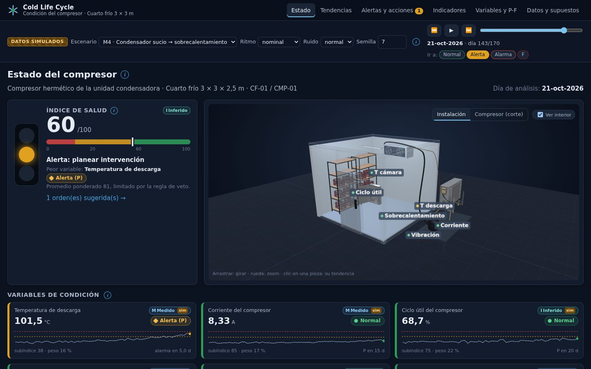

# Cold Life Cycle

**Tablero de condición del compresor de un cuarto frío para conservación de alimentos.** Sirve para decidir cuándo intervenir según los datos y no solo según el calendario.

Proyecto final del Taller en Énfasis II (Gestión de Mantenimiento, 2026-II), Grupo 5. Continúa el trabajo previo del grupo: el ciclo de vida del cuarto frío 3 × 3 × 2,5 m y el AMFEC de su compresor hermético. Está hecho con la misma base técnica que Failaria: web estática, sin servidor, entregada en un solo HTML.



## Cómo abrirla

| Opción | Pasos |
|---|---|
| **Versión entregable** | Doble clic en `ColdLifeCycle.html`. Trae todo adentro (código, librerías y modelos 3D) y no necesita internet ni servidor. |
| Desde el código | `python -m http.server 8000` en esta carpeta → `http://localhost:8000` |

Para regenerar la versión entregable después de un cambio: `node herramientas/empaquetar.mjs`. Requiere Node 18 o superior y usa esbuild vía npx solo para construir. Produce `ColdLifeCycle.html` y `dist/ColdLifeCycle_entrega.zip`, que incluye además un LEEME y un CSV de ejemplo.

## Qué responde cada pestaña

| Pestaña | Pregunta | Contenido |
|---|---|---|
| **Estado** | ¿Cómo está el compresor hoy? | Semáforo e índice de salud 0–100 (pesos por criticidad del AMFEC, regla de veto), modelo 3D con piezas clicables teñidas por estado y vista en corte del compresor, tarjeta por variable |
| **Tendencias** | ¿Cuánto falta para el paro? ¿Alcanza el P-F? | Ajuste lineal/exponencial, proyección ±2σ, tiempo hasta P/paro/F, intervalo P-F consumido, veredicto frente a la preparación de la tarea RCM |
| **Alertas y acciones** | ¿Qué hago, con qué prioridad y en qué plazo? | Orden sugerida por alarma: modo del AMFEC, tarea RCM, prioridad por criticidad C, recurso, plazo, costo de intervenir frente a dejar fallar; CSV |
| **Indicadores** | ¿Cómo va el proceso frente a sus objetivos? | Disponibilidad, MTBF, MTTR y costo acumulado frente a los objetivos del informe |
| **Variables y P-F** | ¿Por qué estas variables, umbrales y pesos? | Método, frecuencia (≤ P-F/2), modos del AMFEC, umbrales de 4 niveles con fuente, curva P-F calculada, AMFEC ↔ RCM |
| **Datos y supuestos** | ¿De dónde sale cada número? | Carga de CSV/Excel, plantilla, medición manual, etiqueta Medido/Inferido/Supuesto por dato, supuestos, fuentes, limitaciones (imprimible) |

La franja superior está en todas las pestañas. Muestra la fuente de datos (**DATOS SIMULADOS** o el nombre del archivo), el escenario de falla, el día de análisis y la reproducción ▶. Los atajos **Ir a: Normal / Alerta / Alarma / F** prueban el semáforo en sus tres estados. Teclado: espacio para reproducir, ← → para cambiar de día (Shift: una semana).

## Escenarios del simulador

Cada escenario recorre condición normal → alerta (P) → paro → falla funcional (F) y degrada la variable que anticipa su modo de falla:

| Escenario | Modo (C) | Variable primaria |
|---|---|---|
| Condensador sucio → sobrecalentamiento | M4 (45) | Temperatura de descarga |
| Fuga lenta de refrigerante | M7 (32) | Ciclo útil |
| Lubricación deficiente → desgaste | M6 (36) | Vibración |
| Escarcha / expansión → retorno de líquido | M5 (30) | Sobrecalentamiento |
| Aislamiento del bobinado degradado | M2 (30) | Corriente |
| Operación normal | — | — |

## Documentación

- [docs/INFORME.md](docs/INFORME.md): informe breve de supuestos, fuentes y limitaciones, con el guion de la demostración para la sustentación. También se imprime desde **Datos y supuestos**.
- [assets/modelos/LICENCIAS.md](assets/modelos/LICENCIAS.md): origen y licencia de los modelos 3D (CC0, Poly Haven).

## Estructura

```text
index.html            shell (pestañas + franja del simulador)
src/config.js         AMFEC, tareas RCM, variables, umbrales con fuente, degradación, escenarios, objetivos, supuestos
src/simulador.js      generador de datos con ruido y falla progresiva                       (sin DOM)
src/analisis.js       estado, subíndice, índice de salud, tendencia, tiempo al umbral, P-F, órdenes, KPIs (sin DOM)
src/datos.js          CSV/Excel → serie diaria, validación, bitácora, plantilla               (sin DOM)
src/app.js            fuente de datos, día de análisis, router, franja del simulador
src/vistas/           estado, tendencias, alertas, indicadores, modelo (Variables y P-F), datos
src/ui/               cuarto3d (Three.js + GLB), grafico (Chart.js), ayuda (ⓘ), formato
assets/modelos/       modelos GLB CC0 (unidad condensadora, estantería, canasta, tablero, luminaria)
vendor/               Three.js r160 + OrbitControls + GLTFLoader, Chart.js 4 + annotation, SheetJS
data/                 ejemplo_mediciones.csv (simulado, para probar la carga)
tests/verify.cjs      79 verificaciones de la lógica:  node tests/verify.cjs
```
